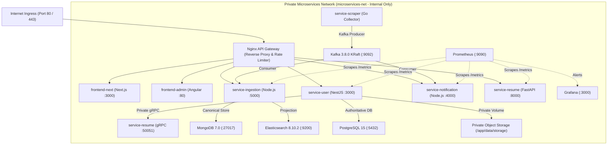

# Seekers Production Operations & Infrastructure Runbook (P14)

Prepared: November 2026  
Status: Authoritative Production Infrastructure, Observability & Recovery Guide  
Architecture: Polyglot Microservices Monorepo with Reproducible Private Staging & Standalone Portfolios

---

## 1. Architecture Topology & Network Boundaries



### Ingress & Boundary Rules:
1. **Zero Host Exposure of Datastores:** PostgreSQL (`5432`), MongoDB (`27017`), Elasticsearch (`9200`), and Kafka (`9092`) have **NO host port bindings** in staging or production. They communicate exclusively over the internal Docker bridge network `microservices-net`.
2. **Gateway Single Point of Ingress:** All candidate and operator requests enter through Nginx on port 80/443. Nginx enforces client request size limits (10MB for resume uploads), exact rate limits (50r/s with burst of 100), upstream timeouts (5s connect, 60s read), and security headers (CSP, HSTS, X-Frame-Options, X-Content-Type-Options).
3. **Correlation ID Forwarding:** Every request carries an `X-Correlation-ID` header. If missing from the client, Nginx synthesizes a unique `$request_id` and forwards it to downstream services.

---

## 2. Independent Project Deployment & Evaluation Recipes

Every one of the 7 projects can be deployed and evaluated independently without spinning up the entire fleet:

| Service | Primary Stack | Independent Run Command | Health Check Probe | Standalone Portfolio Mode |
|---|---|---|---|---|
| **`frontend-next`** | Next.js 15, React 19, TypeScript | `cd frontend-next && npm run dev` | `GET http://localhost:3000/api/health` | Candidate web experience with search, filters, detail view, candidate workspace |
| **`frontend-admin`** | Angular 19, TypeScript, SCSS | `cd frontend-admin && npm start` | `GET http://localhost:4200/index.html` | Operations console with synthetic mock adapter (zero backend needed) or live mode |
| **`service-user`** | NestJS 11, Prisma, PostgreSQL | `cd service-user && npm run start:dev` | `GET http://localhost:3000/users/health` | Identity synchronization, profile management, application tracking, durable erasure |
| **`service-ingestion`** | Node.js 22, Express, Mongo, ES | `cd service-ingestion && npm run start:standalone` | `GET http://localhost:5000/health` | Dual-write catalog ingestion, dead-letter quarantine replay, ES index rebuild |
| **`service-notification`** | Node.js 22, Express, Socket.io | `cd service-notification && npm start` | `GET http://localhost:4000/health` | In-memory durable store with CAPTURE mode (inspect deliveries without SMTP credentials) |
| **`service-resume`** | Python 3.11, FastAPI, spaCy, gRPC | `cd service-resume && uvicorn main:app --port 8000` | `GET http://localhost:8000/health` | Standalone browser demo (`GET /demo`), real `/sample-resume.pdf` extraction |
| **`service-scraper`** | Go 1.23, Playwright, SSRF Guard | `cd service-scraper && go run . -mode=once` | CLI exit code 0 | Standalone CLI crawler (`-source=linkedin`, `-fixture=...`) |

---

## 3. Observability, Metrics & Alert Runbook

Prometheus scrapes all backend services at 15-second intervals via `config-prometheus/prometheus.yml`:
- `notification-service:4000/metrics`
- `ingestion-service:5000/metrics`
- `user-service:3000/metrics`
- `resume-api:8000/metrics`

### Production Alert Rules & Remediation

#### 1. `ServiceDown` (Severity: CRITICAL)
- **Expression:** `up == 0` for 1m
- **Impact:** An upstream application container or service instance has crashed or failed health probes.
- **Triage & Remediation:**
  1. Inspect container logs: `docker compose -f docker-compose.staging.yml logs --tail=100 <service-name>`
  2. Verify resource consumption: `docker stats`
  3. Restart unresponsive container: `docker compose -f docker-compose.staging.yml restart <service-name>`

#### 2. `IngestionDeadLetterSpike` (Severity: CRITICAL)
- **Expression:** `ingestion_dead_letter_total > 10` for 1m
- **Impact:** Malformed, unparseable, or schema-violating crawl events are accumulating in the quarantine queue.
- **Triage & Remediation:**
  1. Log into the Angular Operations Console at `/admin/queues` or query `GET /api/v1/admin/dead-letters`.
  2. Inspect quarantine error codes (`SCHEMA_VIOLATION_INVALID_HASH`, `MALFORMED_JSON`).
  3. If crawler source has drifted, pause connector: `POST /api/v1/admin/sources/:id/pause`.
  4. Fix ingestion parser mapping and replay poison messages: `POST /api/v1/admin/dead-letters/:id/replay`.

#### 3. `NotificationDeliveryFailureHigh` (Severity: WARNING)
- **Expression:** `rate(notification_deliveries_total{status="failed"}[5m]) > 0.05` for 2m
- **Impact:** Delivery failure rate exceeds 5% of attempted notifications.
- **Triage & Remediation:**
  1. Verify SMTP server responsiveness: `curl -v telnet://$SMTP_HOST:$SMTP_PORT`
  2. Check for bounce rates or provider throttling in notification logs.
  3. If staging, ensure `NOTIFICATION_MODE=CAPTURE` is set so no real mail is attempted.

#### 4. `KafkaConsumerLagHigh` (Severity: WARNING)
- **Expression:** `kafka_consumer_lag > 500` for 3m
- **Impact:** Consumers are falling behind producers on `jobs.new` or `job.matches` topics.
- **Triage & Remediation:**
  1. Check ingestion worker processing latency: `GET /api/v1/admin/status`
  2. Scale consumer worker concurrency or check MongoDB write pool saturation.

#### 5. `BackupDrillOverdue` (Severity: WARNING)
- **Expression:** `time() - seekers_backup_last_timestamp_seconds > 86400` for 1h
- **Impact:** No automated disaster recovery restore drill has been executed within the last 24 hours.
- **Triage & Remediation:**
  1. Execute automated restore drill: `node scripts/restore-drill.js`
  2. Check `data/restore_drill/LATEST_RESTORE_REPORT.json` for verified status.

---

## 4. Disaster Recovery, Backup & Restore Drills

### Agreed Target SLA:
- **RPO (Recovery Point Objective):** <= 15 minutes (maximum acceptable data loss window)
- **RTO (Recovery Time Objective):** <= 60 minutes (maximum acceptable restoration duration)

### Backup Procedure
Execute authoritative snapshot pipeline:
```bash
# Real Mode (requires DATABASE_URL and MONGO_URI)
node scripts/backup-stores.js --real

# Local Fixture Demonstration Mode (synthetic staging baseline)
node scripts/backup-stores.js --demo
```
The script:
1. In real mode: dumps PostgreSQL authoritative schema and rows (users, profiles, applications, durable erasures) and MongoDB canonical collections.
2. In fixture demo mode: exports structured synthetic staging state explicitly labeled `FIXTURE_DEMO_NON_PRODUCTION`.
3. Archives private object storage (resumes and export archives).
4. Computes SHA-256 cryptographic checksums for every artifact.
5. Emits `manifest.json` authenticated with an HMAC-SHA256 signature to guarantee tamper-resistant provenance.

### Restoration Drill Procedure
Execute verified restore drill:
```bash
# Real Mode (verifies live restored instances)
node scripts/restore-drill.js --real

# Local Fixture Demonstration Mode
node scripts/restore-drill.js --demo
```
The restoration pipeline validates:
1. **Cryptographic Authenticity & Integrity:** Verifies manifest HMAC signature and individual artifact SHA-256 checksums before unpacking.
2. **Post-Backup Tombstone Replay:** Replays durable erasure tombstones recorded AFTER the backup snapshot timestamp, ensuring deletions made after a backup are never resurrected.
3. **Resurrection Rejection Invariant:** Validates that active directory lookups and sync probes for erased users are rejected with `403 ACCOUNT_PERMANENTLY_ERASED`.
4. **Private Storage Containment:** Automatically purges restored resume assets belonging to erased users.
5. **Search Rebuild:** Rebuilds Elasticsearch projection directly from the restored canonical MongoDB collection.
6. **SLA Targets:** Verifies that operational targets (`RTO <= 60m` and `RPO <= 15m`) are maintained.

---

## 5. Automated Rollback Rehearsal

To safely test reverting a deployment while verifying state preservation:
```bash
# Real Mode
node scripts/rollback-staging.js --real

# Local Fixture Demonstration Mode
node scripts/rollback-staging.js --demo
```
The rollback rehearsal verifies:
1. **OCI Image Digest Validation:** Strictly validates target image digest syntax (`sha256:[a-f0-9]{64}`) to prevent rolling back to invalid or non-immutable tags.
2. **Forward Schema Compatibility:** Confirms that applied database migrations are non-destructive and backward-compatible with the target image.
3. **Durable State Preservation:** Confirms zero data loss across active job catalog items, durable erasure records, and suppression lists.
4. **Service Health Probes:** Evaluates health probe contracts across all 7 services under the rolled-back target.

---

## 6. Basic Operating Cost Analysis

The Seekers platform is engineered for resource efficiency using containerized services. Below is an itemized baseline infrastructure estimate for a single-node staging or initial regional production deployment:

| Component | Architecture / Specification | Provider Benchmark (e.g. Hetzner, DO, Linode) | Estimated Monthly Cost |
|---|---|---|---|
| **Compute & Host** | 1x Dedicated/Cloud VPS (4 vCPU, 8–16 GB RAM, 80–160 GB NVMe) | Hetzner CPX31 / DO Basic Droplet | ~$14.00 – $24.00 / mo |
| **Database Tier** | Containerized PostgreSQL 15 + MongoDB 7.0 on isolated private bridge | Included in host compute/storage | $0.00 additional |
| **Message Broker** | Containerized Kafka 3.8.0 KRaft mode | Included in host compute/storage | $0.00 additional |
| **Search Engine** | Containerized Elasticsearch 8.10.2 (1GB JVM heap limit) | Included in host compute/storage | $0.00 additional |
| **Off-Site Backups** | Encrypted S3-compatible snapshot storage (e.g. Backblaze B2, Cloudflare R2) | 100 GB storage + egress | ~$1.00 – $5.00 / mo |
| **Domain & Edge TLS** | Registered domain + Cloudflare free DNS / automated Let's Encrypt | Standard TLD registrar | ~$1.00 – $2.00 / mo |
| **Observability** | Prometheus v2.54 + Grafana 11.2 (containerized on-node) | Included in host compute/storage | $0.00 additional |
| **Total Estimated Baseline** | **Single-Host Staging / Small-Scale Topology** | **Standard VPS + Off-Site Backups** | **~$16.00 – $31.00 / month** |

*Disclaimer: These figures represent estimated baseline infrastructure costs using commodity VPS providers and do not constitute capacity guarantees or production service level agreements. Production capacity, latency thresholds, concurrency limits, and scaling requirements are empirically measured during Phase 15 performance testing.*

